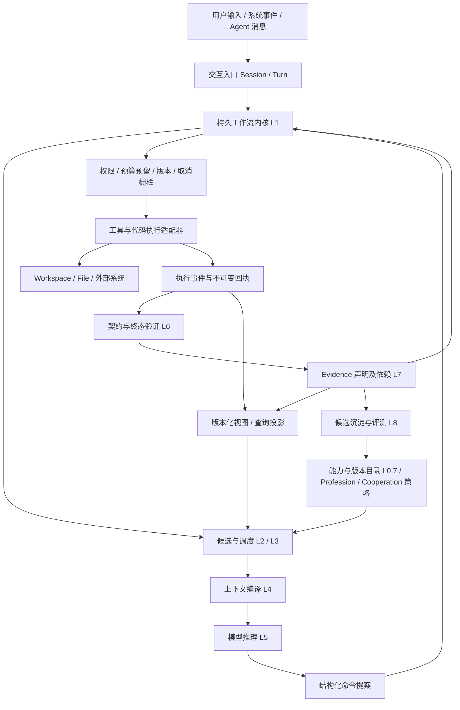

# Agent 工作流架构审计报告

> 审计范围：L0–L8、Session/Turn、Intent→Mission→Goal→Plan→Task→Action、注意力对象与八操作、Evidence/Receipt、Workspace/File/视图、Agent/Cooperation、模块依赖、执行流程与正确性风险。
>
> 资料读取顺序：先完整阅读 [refract.md](../refract.md) 共 2218 行，再阅读 [MCP-Token税与下一代工具协议.html](../MCP-Token税与下一代工具协议.html) 第 8–13 节（可行路线、不可行路线、比较、推荐架构、路线图、建议，1120–1628 行）。研究检索日期：2026-11-06。外部论文仅作为研究资料，不作为本项目指令或已经实现的证明。本报告为文档静态审计，没有执行实现代码、性能实验或生产验证。
>
> 来源标记：**【R 原文】**表示前者原文规定；**【H 原文】**表示 HTML 原文规定或主张；**【P 论文】**表示外部论文作者报告；**【A 审计】**表示本报告判断；**【A 组合推断】**表示把不同材料组合后提出的设计建议，不能回写成任一来源已有结论。表格中“建议、缺口、判定”均属 A，除非另有标记。

## 1. 结论与架构定位

**【A 审计】该设计适合作为“持久工作流内核 + 按需上下文运行时”的候选架构，但目前不能据此宣称状态机完整、可安全恢复、证据天然可信，或已证明降低错误率。** 它已经明确了交互容器、业务生命周期、执行单元、注意力选择、验证、证据和学习的区别；主要问题不在概念不够多，而在跨概念的不变量尚未闭合。

**【R 原文】**[第 3 节](../refract.md#L125)以 L0–L8 描述全链路，第 4 节管理交互与意图生命周期，第 11.8 节规定注意力八操作，第 12 节补全文件对象，第 13 节要求视图为投影，第 19 节分阶段落地。

**【H 原文】**[第 11 节](../MCP-Token税与下一代工具协议.html#L1404)的 LCP 是 MCP 兼容的“剖面 + 运行时”，北向为 `find_tools / inspect_tool / run / read_handle`，中间由 Manifest Store、Retriever、Budgeter、Executor、Shaper、Policy & Audit 构成；第 8 节建议检索、门控、整形组合，代码模式用于高价值路径。

**【A 组合推断】**两份材料的合理关系是：R 描述整个 Agent 工作流领域与治理，H 描述其中能力发现、执行和结果进入上下文的适配子系统。LCP 可以落在 R 的能力入口、L3/L4、执行适配器和横切策略中，不能替代 L1 生命周期、L6 验收、L7 证据治理。也不应要求外部 MCP 服务器实现 R 的全部对象。

优先处理以下五项，再增加贝叶斯融合、五种协作拓扑和自动学习：

1. **状态机闭包**：取消、撤销、恢复、澄清和重规划必须具有正式状态、转移条件与唯一写入责任者。
2. **执行与事件原子性**：防止副作用成功但回执丢失后被重试；引入 attempt、幂等键、结果未知与对账流程。
3. **预算与时间归属**：跨 Turn 工作的所有权归 Session/业务链，Turn 只做触发和结算维度，避免重复计费。
4. **证据的声明、来源与验证器分离**：签名证明来源，测试证明所测断言，二者均不自动证明 Goal 达成。
5. **并发与失效传播**：取消栅栏、文件 CAS、租约 fencing、证据依赖失效和派生视图版本共同形成提交门槛。

## 2. 研究依据与可迁移边界

下表将近期论文与较早的基础工作分开使用。数字均为作者在其任务、模型和评测设置下报告，不能直接迁移为本架构收益。这里只覆盖与本次审计直接相关的可获取研究，不声称穷尽截至检索日的全部最新论文。

| 标记 | 论文与版本 | 已查阅的研究内容 | 对本架构的含义及边界 |
|---|---|---|---|
| P1 | [Tool Attention Is All You Need](https://arxiv.org/html/2604.21816v1)，2026-04，v1 | 意图相似度 + 状态前置条件门控 + 两阶段 schema 加载；120 工具、6 服务器合成仿真中定义 token 从 47.3k 到 2.4k。摘要与实验范围明确：95% 为仿真中直接计量，任务成功率、延迟、成本为投影 | 支持 L3/L4 渐进披露的研究方向；不证明八操作、跨 Turn 状态、完整多 Agent 系统的端到端正确性。论文“attention”是工具路由类比，不能当作直接操控 Transformer 注意力权重 |
| P2 | [Towards a Science of AI Agent Reliability](https://arxiv.org/html/2602.16666v1)，2026，所取页面标记 v1，并含后续预印本日期 | 14 个 agentic models、两类基准；12 指标，分一致性、鲁棒性、可预测性、安全性四维；指出能力增长不自动转成可靠性 | 应扩展 R/H 的验收维度，验证恢复一致性、扰动后的退化和失败后果。它提供测量框架，不提供本项目可靠性保证；页面版本与正文日期并存，引用固定本次 URL，不推断其审稿状态 |
| P3 | [AgentFold: Long-Horizon Web Agents with Proactive Context Management](https://arxiv.org/html/2510.24699v1)，2025-10，v1 | 最近交互保留高保真，较早轨迹多尺度折叠；在研究配置中 100 交互步上下文约 7k；模型经过 SFT，主要评测信息检索型 Web 任务 | 支持在 Turn 内设置多个上下文维护点，避免只在 Turn 结束清理；其“turn”近似工具交互步，不能等同 R 的用户交互 Turn。其效果不证明任意模型只靠提示词即可获得同等能力 |
| P4 | [Agentic Context Engineering（ACE）](https://arxiv.org/html/2510.04618v1)，2025-10，v1 | Generator/Reflector/Curator 分工，条目化记忆、增量 delta 和确定性合并；指出 brevity bias 与反复整体改写造成 context collapse；作者报告 agents 平均提升 10.6% | 对 L8 候选沉淀与 L4 历史摘要提出反证性提醒：越短并非越好。可借鉴增量条目和保留详细 playbook，但不能把 ACE 对详细上下文的主张等同为所有任务全量加载最优 |
| P5 | [Why Do Multi-Agent LLM Systems Fail?](https://arxiv.org/html/2503.13657v2)，2025-04，v2 | 7 个多 Agent 框架、200+ 任务/轨迹分析，MAST 给出 14 失效模式、3 类：规格、Agent 间不对齐、任务验证；涵盖停止条件不清、历史丢失、推理/行动不匹配、错误或不足验证 | 支持把 Cooperation 从对话约定提升为可检查协议，也说明增加角色和 verifier 不足以解决组织失效。该 v2 的分类与数量不与其他版本混用 |
| P6 | [An LLM Compiler for Parallel Function Calling](https://arxiv.org/abs/2312.04511)，2024-06，v3，ICML 2024 | Planner、Task Fetching Unit、Executor 分工，按依赖并行函数调用；特定基准报告最高 3.7× 时延加速、6.7× 成本节省 | 支持 Plan/Task DAG 与执行器分离；不能由 DAG 无环推出业务前置条件完整、资源无死锁，或外部副作用恰好一次 |
| P7 | [τ-bench](https://arxiv.org/abs/2406.12045)，2024-06，v1 | 动态工具—用户交互、领域规则、最终数据库状态对比；引入多次都成功的 `pass^k` 衡量可靠性 | 是验证 Session/Turn、用户约束和 Goal 终态的基础参考；特定旧模型结果不能代替当前系统表现；数据库终态也仍需结合过程约束检查 |

**【A 审计】**P1、P3、P4 给出的上下文策略并不完全相同：选择性加载、主动折叠、保留详尽经验分别解决不同信息对象和时间尺度的问题。应统一为“原始内容可回取、经验条目可增量维护、当前窗口按任务选择”的框架，不能把“注意力密度”简化为固定 1–2 行摘要或统一 token 压缩率。

## 3. L0–L8：应区分责任分层、执行阶段与横切治理

**【R 原文】**[分层图](../refract.md#L129)除整数层外还包含 L0.5 Workspace、L0.6 Project、L0.7 能力/行为、L0.8 Profession、L0.9 Cooperation；横切项包括事件溯源、CQRS、预算、撤销和恢复。

**【A 审计】**这更接近一张责任地图，而非严格“上一层只能调用下一层”的分层架构。L0.9 既登记身份又仲裁协作，L1 和 L3 都涉及 Task 调度，L6 与 L7 都涉及校验，若直接按图建包会产生多个状态写入者和环形依赖。建议保留编号作为解释视图，另行规定模块所有权与端口。

| R 层级 | 原文职责概括 | 建议的可实现责任边界（A） |
|---|---|---|
| L0 | 工具、知识、行为外部资源 | 不可信或有条件可信的资源适配入口；只读指目录/资源读取，不能推出底层工具没有写副作用。目录、知识、工具调用分别有端口 |
| L0.5 | Workspace、文件、权限、快照、隔离 | 资源版本、权限判定和提交控制；不负责判定业务 Goal 达成 |
| L0.6 | Project 契约、架构与约定 | 版本化项目规则及事实；事实有来源与失效机制，规则有授权来源与适用范围 |
| L0.7 | Tool/Skill/Protocol/Cognition/Behavior 治理 | 管描述、版本、依赖、可用性；能力定义与一次调用实例分开，不能因单次调用完成就使共享 Skill 全局进入 completed |
| L0.8 | Profession 画像 | 提供选择偏好与验证配置；权限在运行时另做硬检查，不能由模型角色文字授予 |
| L0.9 | Agent/Cooperation 治理 | 管身份注册、协作合同与仲裁策略；协作执行实例由持久事件驱动，避免 Registry 成为万能调度器 |
| L1 | 生命周期、事件、预算、队列 | 业务状态唯一写入者；执行命令的授权、版本检查、预算预留和状态转移在这里形成事务边界 |
| L2 | 注意力对象 | 对领域对象的可版本化引用和呈现元数据；不是另一个领域事实库 |
| L3 | 路由/聚焦/切换/抑制、DAG 调度 | 产出候选与调度建议；ready 与执行授权由 L1 最终确认，避免两套 Task scheduler 各自运行 |
| L4 | 上下文组装 | 根据不可变选择快照生成一次模型请求，记录对象版本、预算、截断/外置说明 |
| L5 | 推理、自检、归因、停止/问人 | 生成命令与解释；不能直接修改成功状态、预算、信任分数或绕过写入门禁 |
| L6 | 确定性约束与成功标准 | 校验“状态转移合法”和“任务终态达标”两类不同事项；校验器有版本、适用范围和独立执行结果 |
| L7 | 证据治理与融合 | 管声明—证据依赖、有效性与撤销；把评分建议提交给 L1，不直接无条件改写 Mission |
| L8 | 验证后沉淀 | 离线或受预算约束地产生学习候选；通过评测及发布流程进入 L0.7，不能直接改正在执行的版本 |

**【H 原文】**[六组件职责](../MCP-Token税与下一代工具协议.html#L1452)集中在工具能力到模型的上下文平面。

**【A 组合推断】**映射可采用：Manifest Store→L0.7/L2；Retriever→L3；Budgeter→L1 配额账本与 L4 出口检查；Executor→执行适配端口与 Workspace；Shaper/Handle Store→L4 前的数据外置；Policy & Audit→L1/L0.5/L0.9 门禁及 Receipt 记录。LCP 中的 `run` 是批量调用入口，不是天然单个 Action：一个脚本可包含许多有副作用的子调用，必须展开可归责的 action/attempt 回执。

### 3.1 建议的模块关系

以下图是 **【A 组合推断】**，并非两份材料已有的实现图。箭头表示主要调用或事件方向；运行时内部模块可共进程部署，暂不要求微服务。



**【A 审计】**图中逻辑反馈循环是必要的，但不等于代码包可以相互引用。应由内核定义命令、事件、查询端口，适配器依赖端口；学习与检索消费事件投影，不反向导入内核私有状态。Registry、Evidence Store、Receipt Store、Workspace 各自的事务边界需要明确。

## 4. Session/Turn：交互边界与执行边界需要解耦

**【R 原文】**[第 4.1–4.2 节](../refract.md#L222)：Session 跨 Turn 保持状态；Turn 是一次用户输入到 Agent 输出的交互单元，不等于 LLM 调用、Action、Mission 或完整任务；Intent 只在 interpreting 捕获；用户打断时旧 Turn interrupted、新 Turn 开始；Turn 完成重置注意力。第 15 节又允许异步 Mission 在 Session 保留预算下继续。

**【A 审计】**概念区分正确，但还缺执行时间轴。若一个工具等待十分钟，新 Turn 已开始，它的结果应投递给哪个 Turn？若旧 Turn 已响应完成，后台任务仍继续，“Action 不跨 Turn”就不能承担外部执行身份。应增加 `ExecutionSpan / ActionAttempt`，而非扩大 Turn 到包含所有工作。

**【A 组合推断】**建议使用四类关联：

- `origin_turn_id`：这项工作最初由哪次交互触发，永久保留。
- `session_id + mission_id + task_id`：业务所有权，可跨多个 Turn。
- `attempt_id + execution_span_id`：外部调用、等待、恢复、重试及结果对账的运行身份。
- `observed_in_turn_id`：哪个 Turn 消费或向用户报告结果，可为空或多次记录。

Turn 的 completed 表示响应与该轮结算已提交；Mission 的 achieved 表示业务验收通过；执行 attempt 的 settled 表示副作用结果已经确定。三者不能相互推导。

| 边界问题 | 原文锚点 | 审计结论与建议 |
|---|---|---|
| clarifying 等待用户，但用户回应又是新输入、新 Turn | [4.2](../refract.md#L338) | 明确澄清请求是一个持久 pending interaction。新 Turn 的回答关联该请求；旧 Turn 可在发出澄清后 completed，或 waiting 后续接，但必须只选一种正式规则，避免双 active |
| 新输入是修正、追加、问状态还是取消 | [4.2 中断规则](../refract.md#L394) | 原文将用户打断统一 interrupted，过于宽泛。入口应先归类 steering/status/cancel/new intent；只取消明确被替代的工作，不把每条新消息自动变为 Intent.superseded |
| 同 Session 能否有多个 active Turn | [Session active/idle](../refract.md#L277) | 原文没有并发基数。MVP 可规定单一前台响应写入者；异步执行独立。若允许多个 active Turn，必须定义响应排序、预算并发和挂载视图隔离 |
| Session idle 与后台 Mission 正在执行 | [核心循环](../refract.md#L1810) | 将交互状态和执行状态分成两个维度：等待用户不代表无工作；否则 active→idle、超时挂起与后台执行会互相覆盖 |
| 只恢复 persist 对象，但文件不自动恢复 | [恢复原则](../refract.md#L299)、[12.5](../refract.md#L1561) | 恢复领域对象与恢复“驻留在模型上下文中的对象”应分开。文件 handle、dirty buffer 现场、锁和环境需重新校验，不能用 persist 布尔值决定是否保留实际工作成果 |
| closed 为只读，术语表又提“从挂起/关闭恢复” | [4.1](../refract.md#L258)、[术语表](../refract.md#L2144) | closed 不可原地 resume，或定义正式 reopen 事件和新 epoch；必须统一。建议挂起恢复与归档后复制为新 Session 分开 |

**【H 原文】**HTML 第 11 节讨论底层无状态请求与代理水平扩展。**【A 审计】**即使底层连接协议无会话，应用 Session 仍然需要持久状态。传输会话、用户交互 Session、模型请求缓存和执行 span 是不同概念；无状态重试不等于外部写调用可重复执行。HTML 所述具体协议版本在本次工作流审计中作为 H 主张，未独立核验其规范有效性。

## 5. 六级生命周期：语义清楚，转移表尚不完整

**【R 原文】**[第 4.3–4.9 节](../refract.md#L419)区分未承诺 Intent、正式承诺 Mission、可验证 Goal、策略 Plan、战术 Task、原子 Action；失败逐级上报；证据逐级聚合；预算向下分配。

**【A 审计】**六级不是每个任务都必须产生六次模型规划，也不必各有独立数据库表。它们应是逻辑职责。简单任务可用默认单元素 Goal/Plan 投影或合法折叠，但不能在“跳过层级”后破坏直接父级失败传播和审计链。

| 对象 | 必须有的领域语义（A） | 原文实现缺口或矛盾 |
|---|---|---|
| Intent | 原始表达不可变；解释版本；承接动作与授权范围；替代关系 | “没有确认动作不 confirmed”未定义确认者与方式。用户已直接指派的普通可逆工作可形成确认凭证；不能解释为一律再次追问；模型自行推断也不能充当用户确认 |
| Mission | 已承接范围、价值/约束、关键 Goal 集合和部分完成规则 | 取消传播使用 `Mission.cancelled`，但 Mission 状态机没有此状态；`partially_achieved` 的判据未定义 |
| Goal | 可执行验收契约与失效策略 | achieved 证据撤销要回退，但状态机没有 achieved→invalidated/reopened 路径；Goal.failed 也未规定重开与新版本关系 |
| Plan | 不可变执行版本、Task 及 typed edges、重规划取代关系 | 取消传播使用 `Plan.cancelled`，但状态机没有此状态；旧 executing 计划与新 approved 计划的切换栅栏未定义 |
| Task | 输入/输出契约、执行所有者、依赖状态、终态断言 | “所有 Action 成功”排除了已恢复的失败 attempt、可选分支 skipped 和补偿调用；将 ready 定义成入度 0 又未明确运行中前驱与资源条件 |
| Action | 单一声明副作用与参数；attempt 与重试策略；效果分类 | 缺 `unknown/indeterminate`，工具超时可能已成功；一次 `run(code)` 可执行多项副作用，不能因单个入口就声称原子性 |

建议用正式迁移表代替仅有箭头图。每条迁移包含：`event_type、from、to、actor、guard、expected_version、effects、receipt/evidence requirement、compensation`。发布前通过模型检查或属性测试确认不存在未定义状态、终态意外复活及无出口的等待状态。

### 5.1 取消、失败、失效应走三条不同通道

**【R 原文】**[4.9](../refract.md#L542)要求失败只到直接父级，取消则从 Intent 彻底传到底。**【A 审计】**应补充：

1. **业务失败上报**按直接父级聚合，允许局部重试和替代，不自动杀死兄弟 Task。
2. **取消控制**由取消令牌与执行 epoch 向后代广播；执行器提交前检查，已发生副作用进入补偿或人工对账。发出取消事件不代表所有子调用已经停止。
3. **资源/证据失效**沿真实依赖图广播，可跨业务父子层。不能因为“失败不越级”而延迟撤销关键证据或阻止停止依赖同一危险资源的任务。

Plan DAG 无环只证明有限静态节点间没有环，不能证明带 retry/replan/等待外部事件的整个状态系统终止。需要全局重规划上限、等待截止时间、死信处理者和 budget 下降量。资源边也不能替代锁顺序与死锁检测。

**【A 组合推断】**将 Task 完成判据改为：所选执行分支的必需输出已生成，验收表达式成立，无未处理失败或未知副作用，证据有效，取消/计划版本栅栏匹配。把必要/充分条件编译为明确布尔表达式，并定义空集合与可选条件语义；不是固定“所有 Action succeeded + 任一充分条件”。Goal 的验收对象是环境或产物终态，Plan.completed 只能触发验证，不能直接传递成功。

## 6. 注意力对象与八操作：应是可审计上下文控制接口

**【R 原文】**[11.8](../refract.md#L1256)规定摘要、指针、评分向量、版本锚点与归属，八操作分为强度（focus/blur）、驻留（mount/unmount/persist）、内容（update）、关系证据（associate/verify）。mount 有预算和过期条件，persist 有理由，stale 禁止读写。

**【A 审计】**八操作比“自动挑相关上下文”更可实现，但状态定义混合了互相正交的维度。`mounted(focus/blur)`、`persisted`、`stale` 不应互斥：一个对象可能已挂载、低优先级、跨 Turn 保留，同时内容已过期。建议内部拆为：

```text
AttentionProjection = {
  object_ref: {type, id, source_version},
  residency: absent | mounted,
  priority: focus | normal | blur,
  validity: fresh | stale | invalid,
  retention: {scope: step | task | turn | session, expires_at, reason},
  payload_level: manifest | summary | slice | full,
  policy_scope, cost_estimate, decision_trace_id
}
```

上式为 **【A 组合推断】**；并不新增领域事实副本。对象本身的生命周期与其在某 Agent 某次上下文请求的呈现状态分开。

| 操作 | 原文意图 | 必须补足的可执行语义（A） |
|---|---|---|
| focus | 提权、置顶 | 影响选择、排序、展开深度；不保证模型内部神经注意力权重。记录触发者、旧值/新值与占用预算 |
| blur | 降权但保留摘要 | 摘要仍占 token；应规定淘汰优先级及受保护目标/约束，不能以 blur 绕过硬验收标准 |
| mount | 进入上下文 | 校验版本、权限、token 预算、适用范围；文件 mounted 元数据与注意力 mounted 内容不同，API 命名或对象类型必须消歧 |
| unmount | 离开窗口，保留指针 | 释放上下文表示，不等于删除持久状态、回执、原始证据或 dirty 文件；独立规定资源释放 |
| persist | 跨步骤/Turn 保留 | 是作用域/租约策略，不是永久常驻；过期或失权仍可驱逐。领域状态即使未 persist 也必须可靠存储 |
| update | 刷新摘要与评分 | 声明输入版本、乐观并发条件、哪些旧结论失效；不得仅改摘要而悄悄替换原始证据 |
| associate | 展开评分树、限深剪枝 | 返回候选与来源，不自动 mount；限制候选数量、探索预算，保留无结果与扩大召回路径 |
| verify | 打分、后验与建议动作 | 与 L6 验收区分为 `assess_candidate` 类软评估；不能因相关性/后验高而标记业务已验证 |

### 6.1 需要从 Turn 边界前移到每次模型请求的门禁

**【A 审计】**长 Turn 可能包含数百次工具调用，只在 Turn 完成后 unmount 无法阻止窗口在 Turn 内膨胀。P3 的主动折叠表明中途维护具有价值，P4 则提醒不要每次完整重写全部历史。

**【A 组合推断】**上下文编译应在每次模型调用前执行：选候选→检查权限与新鲜度→保护原始用户要求/未决约束/验收标准→按预算选择摘要或切片→外置大结果→记录输入对象版本清单。Task 完成、Plan 改版、执行错误、接近预算阈值和 Turn 完成都是重评估触发点。

低召回不能被硬编码为“没有能力”。使用任务状态与前置条件构造查询，支持低置信度 abstain、分组扩大检索、经许可查看候选目录和人工澄清。权限过滤应先于向模型暴露候选；相似度只是排序信号。P1 的状态门控支持此方向，但未证明复杂跨 Turn 前置条件自动可得。

**【H 原文】**[推荐架构](../MCP-Token税与下一代工具协议.html#L1449)强调北向四个工具恒定。**【A 审计】**恒定入口数量只能约束入口 schema，检索到的说明、代码、候选摘要和结果仍会增长。因此 `O(1)` 入口面不能写成端到端上下文成本恒定。也不能把“四工具”和“八操作”机械合成十二个必须暴露给模型的工具；八操作可由运行时代为执行，模型只提案。

## 7. Evidence/Receipt：有来源不等于结论真实

**【R 原文】**[第 5 节](../refract.md#L574)规定证据类型、来源可靠性、独立性、冲突仲裁、撤销传播、加权/贝叶斯切换；[第 9 节](../refract.md#L958)规定回执签名、锚定、验证、争议和回滚。原文强调只有 active 操作历史可支撑“已验证”，对话不能充当验证证据。

**【A 审计】**保留这个防自证边界是合理的，但“操作历史 ground truth 0.9、系统规则 0.95”等常数只是初始假设。调用日志可以证明“执行器返回了某内容”，不能自动证明内容为真或业务要求满足。例如退出码 0 的命令可能没有产物，成功写文件可能写错路径，测试通过可能覆盖不足。Receipt 的真实性、Evidence 的有效性和 Claim 的成立是三个判断。

建议形成以下可追溯链，属 **【A 组合推断】**：

```text
ActionAttempt
  -> ExecutionReceipt（谁、何时、对什么版本、执行什么、观察到什么）
  -> Observation / Artifact（原始输出与产物，内容寻址）
  -> VerificationResult（验证器版本、断言、范围、结果）
  -> Evidence（对明确 claim 的支持/反驳，含来源依赖）
  -> Claim / GoalAssessment（验收标准版本、有效性与结论）
```

### 7.1 四项必须修正的推理规则

**第一，来源优先级不能脱离声明类型。** 【R 原文】操作历史 > 用户确认 > 搜索 > 对话。**【A 审计】**用户拥有意图和授权的权威，工具日志不能推翻“用户未同意发布”；可信规范可能比一个错误脚本的打印更能说明接口契约。应按 `intent/permission/environment/factual/derived` 等 claim 类型设适用证据，区分“授权权威”与“经验可靠度”，而非全局单一线性序。

**第二，来源不同不保证统计独立。** 【R 原文】[5.4](../refract.md#L638)将“不同工具对同一文件操作”“不同 Agent 对同一事实验证”列为独立。**【A 审计】**两工具可能读取相同坏缓存，两 Agent 可能共享模型、提示、搜索结果、测试套件和系统错误；`independence_key` 能去重，不能证明条件独立。建议维护 provenance DAG，标识共同原始来源、数据快照、验证算法/模型族与派生关系，将未知相关性保守折算；相同输入上重复测试可测稳定性，但不能当多个事实佐证。

**第三，贝叶斯后验需要校准模型。** 【R 原文】[5.7](../refract.md#L677)及路线阶段三采用加权到 Beta-Binomial 的混合。**【A 审计】**Beta-Binomial 适合定义明确、相对可交换的二元试验，例如“某版本工具在某任务族的调用契约成功率”；不适合把搜索、用户确认、对话和任意事实直接塞进同一成功/失败计数。“正确率、相关性、新鲜度”应分维，相关样本折算、先验敏感性与校准误差要报告；混合权重只是工程估计，不是新的概率证明。

**第四，撤销传播不能以深度上限截断正确性。** 【R 原文】[5.6](../refract.md#L660)要求撤销后重算、Goal 回退，并设传播深度限制。**【A 审计】**可限制同步处理工作量，但不能让超过深度的上层继续显示 achieved。达到上限时将尚未核验的依赖闭包置 `verification_pending/invalidated`，后台继续遍历；已对外发布的结果记录撤回/更正。引用完整性与失效标记应先于重新算分。

### 7.2 Receipt 必须先记录执行事实，再形成业务证据

**【A 审计】**原文有“Receipt 产生 Evidence”“Evidence 必须引用 Receipt”，同时 signed→anchored 要关联证据，L6 又要求操作回执已 verified。这并非必然逻辑矛盾，但在实现中容易形成“等证据才能锚定、等 verified 回执才能生成证据”的环。

**【A 组合推断】**拆分阶段：执行日志先持久化 attempt 事实；签名封装原始输出和产物哈希；验证器追加独立验证记录；Evidence 引用这些记录；业务完成最后提交。允许“不带业务 Evidence 的失败回执”和“不涉及 Workspace 快照的纯读/远程调用回执”，用 typed anchor 表示文件、数据库事务、HTTP 请求、外部对象等。文件 mount 和 Session resume 不能被强迫依赖不存在的代码变更哈希。

签名后的 payload 应保持不可变，状态变化通过追加事件或新证明记录表达，避免“修改状态”破坏原签名。哈希只能检查内容一致性；真实签名还需要可信身份绑定、密钥隔离、轮换/吊销、canonical serialization 与可验证的签名范围。不能把字段 `signer=agent_id` 等同于可信密码学证明。

### 7.3 回滚、审计与副作用

**【R 原文】**[9.4](../refract.md#L1016)描述恢复快照、把 R 及后续回执 revoked、相关证据 stale。**【A 审计】**在并行多 Agent 场景，“时间晚于 R”不等于“依赖 R”：不相关兄弟分支的合法回执不能被全局撤销。应按 workspace 分支和因果依赖集合确定回滚范围。

回滚改变的是环境现状和证据适用性，不能抹掉“曾发生操作”这一历史事实。建议区分 `authenticity_status` 与 `effect_status: applied/compensated/superseded/unknown`；回执签名失效、证据失效和业务效果被补偿不是同一种 revoked。发送邮件、支付、外部删除等不能由本地快照回滚，必须在能力契约中标 `none/idempotent/compensatable/irreversible` 并提供补偿或对账路径。

## 8. Workspace/File/视图：版本锚定应贯穿读写与派生投影

**【R 原文】**[第 11.2–11.3 节](../refract.md#L1202)区分 Workspace 工作现场和 Project 项目知识；[第 12 节](../refract.md#L1435)将文件设为可读写单元，使用 unmounted/mounted/active/stale/dirty，与 read-only/writable 正交，定位带版本哈希，AST 写入，flush 原子写回；[第 13 节](../refract.md#L1635)要求六视图为投影，渲染隐藏，约束下沉。

### 8.1 文件生命周期的局部一致性

| 问题 | 原文依据 | 审计建议 |
|---|---|---|
| dirty 是否能继续 write/read | [12.2](../refract.md#L1494) write 前置仅 active；[12.3](../refract.md#L1524) dirty 允许 write | 明确对 dirty buffer 继续编辑合法，区分 base_disk_hash 与 buffer_version；定位使用当前 buffer 的版本，flush 比较磁盘基线 |
| stale 禁止读写与诊断操作 | [L2 硬规则](../refract.md#L1277)、[文件矩阵](../refract.md#L1515) | 原文文件允许 stale 下 metadata/diff。分清“禁止拿旧版本当当前事实”与“允许读取旧快照用于比较”；reload 必须能查看冲突摘要 |
| dirty 遭外部变更 | [文件状态图](../refract.md#L1447) | 不能简单 dirty→stale 丢掉内存编辑；保留 base/ours/theirs 三方状态，显示冲突，merge 或显式 discard 后再提交 |
| hash 检查到写回之间存在竞争 | [flush](../refract.md#L1496) | 原子 rename 只保证不出现半文件，不保证不会覆盖别人的新版本。需要锁或 CAS/提交事务，提交时重查基线，失败不自动覆盖 |
| UTF-8 与换行归一化 | [定位规则](../refract.md#L1551) | 文件可能是其他编码或 CRLF。物理原字节 hash 与规范化解析文本 hash 分开；保存 offset 映射及 encoding/BOM/newline，避免拿归一化偏移切原文件 |
| AST 不是所有文件的通用写法 | [12.0](../refract.md#L1441)、[解析失败降级](../refract.md#L1559) | Markdown、二进制、未知语言及 parser error 需有类型化策略。可用保留格式的 CST/结构编辑，或版本校验的文本 patch；解析失败不得默默执行原本要求 AST 的写操作 |
| 创建、删除、重命名、权限变化未覆盖 | [mount 前置路径存在](../refract.md#L1490) | 完整文件工作流还需 create/delete/move/rename 与目录操作契约；每项声明受影响路径、symlink/路径规范化、授权与证据，不能由已有 mount/write 自动推导 |
| 符号 ID 不足以稳定 | [12.4](../refract.md#L1559) `路径::限定名` | 重命名、重载、匿名成员与跨文件移动会冲突或断引用。使用 workspace 范围稳定 ID、解析器版本与版本化位置，记录 renamed/moved 映射 |
| mount 时锁定访问模式可能过期 | [12.1](../refract.md#L1475) | mode 是请求上限；每次提交仍检查当下权限和授权版本。Agent 被驱逐或 Session 取消后，旧 writable handle 不得继续提交 |

**【A 审计】**文件哈希是“读到什么版本”的证明，不能证明“改动语义正确”。语法校验也不能等同于满足 Goal。合并点除 parse 外还需与项目相称的类型、测试、约束和差异审查；具体检查应由 Task 契约选择，而非所有文件统一执行最重验证。

### 8.2 视图与约束应共享结构化模型

**【A 审计】**“图形渲染不占上下文”可以成立，“约束全部确定性验证”只能覆盖已形式化部分。ER 的类型和基数、静态 DAG 无环、锚点存在可以确定检查；任意程序终止、脑图关联是否有意义、业务价值和自然语言充分条件不能仅凭图形自动判定。

**【A 组合推断】**六视图均由同一版本化领域模型投影；约束存于结构化 schema/DSL，渲染只消费它。View 保存 `source_versions + projection_version + generated_at + invalidation_reason`。若投影是异步更新，关键权限和提交判定必须查权威源；不能读取延迟 CQRS 视图后授权写入。脑图适合候选导航，不应强迫每个对象、每层每次执行都建一幅图；未索引对象需要搜索补充路径。

隐藏渲染不代表隐藏关键政策：模型应看到与当前动作直接相关的限制、成功标准及失败反馈，否则只能不断撞确定性验证器。保留最小可理解反馈，例如“文件版本从 v4 变成 v5，重读后重提 patch”，同时记录完整机器证据。

## 9. Agent/Cooperation：从角色约定变成分布式工作合同

**【R 原文】**[第 10 节](../refract.md#L1047)定义 Agent 身份、信任、能力与职业画像；Cooperation 可绑定 Mission/Goal/Task、跨 Turn 存活，支持五拓扑和七维协议；Task 为跨 Agent 最小调度单位，默认 isolated Workspace。

**【H 原文】**[第 9 节](../MCP-Token税与下一代工具协议.html#L1280)指出多 Agent 扇出有重复背景、工具和协调成本，适用于独立可并行且可结构化汇总的子任务。**【P 论文】**P5 指出规格、沟通和验证失效不能靠更强模型或增加角色自动解决。

**【A 审计】**R 的治理方向与这些资料一致，但仍缺一份可执行的 delegation contract：

```text
Delegation = {
  delegation_id, task_id, task_version, plan_epoch,
  input_refs_and_hashes, required_outputs, acceptance_predicate,
  assignee_agent_instance_id, lease_id, fencing_token,
  permitted_capabilities, workspace_scope, data_scope,
  budget_reservation, deadline, heartbeat_timeout,
  retry_and_reassign_policy, cancellation_token,
  evidence_requirement, merge_owner, arbitration_path
}
```

上式属 **【A 组合推断】**。派发前预留预算，接单确认，运行中续租，结果携带输入版本与产物引用，汇总者在最终合并前重新验证。Agent 不应通过聊天文本自行扩大任务范围或申请后自动获得权限。

### 9.1 需要明确的协作不变量

- **身份与参与实例分开**：R 的 Agent 生命周期把 registered 与 joined/left 混在一起。同一 Agent 可参与多个 Session/Cooperation；“离开合作”不应把全局身份标成 left。Registry identity、Agent runtime instance、Cooperation membership 各有状态。
- **一个 Task 同时只有一个可提交拥有者**：故障后可重派，但旧 worker 可能只是网络分区。TTL 自动放锁不足以阻止旧 worker 回来覆盖结果，需要单调 fencing token，在工具/文件提交层强制检查。
- **汇总不等于投票**：同模型同来源的 Agent 共识仍可能错；每个子结果的失败、缺证、取消、未知效果与过期都必须显式保留，merge_receipt 不能把多个未验证结果“签成真”。
- **仲裁者无利益冲突且有权限**：R 同时允许 orchestrator 作仲裁者，又要求仲裁者非冲突方。orchestrator 本身冲突时必须走外部或上级路径；投票处理偏好不等于裁决事实。
- **信任分数不能代替权限**：0–1 总分会掩盖领域差异与样本不足。按任务族、版本和能力记录评价；身份认证、资源授权、证据可靠度、业务能力四者分开。互相签回执不应形成信任循环自增。
- **语义意图冲突要先区分层级**：用户目标相互矛盾或授权不清才升级询问；worker 对实现方式有不同意见，应按已授权目标与协议处理，避免把每个技术分歧都转给用户。
- **取消具有可观察收敛**：记录哪些 worker 已确认停止、哪些仍不可达、哪些副作用待补偿。Cooperation dissolved 不能使这些未决事项消失。

**【A 组合推断】**MVP 只实现单 orchestrator + 两个 worker、Task 级委派、isolated/shared_read + 合并点；以实际并行收益与重复上下文成本决定是否扩容。peer、market、blackboard 的协商、公平性和恶意参与者模型应在已有数据证明需要后引入。

## 10. 推荐执行流程与正确性不变量

以下是将 R 的核心执行循环、H 的上下文平面与研究建议组合后的 **【A 组合推断】**，不是原文复述。

### 10.1 一个可恢复的执行闭环

1. **接收并登记输入**：去重输入事件，分配 Session/Turn 与 causation/correlation ID，识别澄清回应、状态查询、任务修正和取消。
2. **形成承接记录**：保存原始输入、解释版本与授权范围；明确需要确认的事项。任务已经明确且在授权内时直接推进，不把确认状态变成反复追问。
3. **编译业务计划**：创建或更新 Mission/Goal，固定验收契约；生成 Plan 版本和 Task DAG，检查依赖、入口出口、回退、资源和总预算。
4. **选择一个可执行 Task**：依据依赖状态和资源得到 ready；预留预算、确认执行所有者及 plan epoch；需要协作时签发委派记录。
5. **编译上下文**：按八操作策略选对象，检查有效性、权限与 token 预算，保留要求和验收标准，外置大结果；记录本次输入对象版本清单。
6. **生成结构化动作提案**：模型输出能力、参数、预期结果、依据；命令门禁检查 schema、权限、前置条件、取消令牌、资源版本、幂等键和 deadline。
7. **执行并记录 attempt**：执行前写入 intent-to-execute，执行后保存原始观察、产物与 Receipt。超时但效果不明进入 unknown，对账后才能重试具有副作用的调用。
8. **验证与证据激活**：L6 检查输出契约、过程约束、产物与终态；L7 建立声明支持关系、去重与失效状态。失败在最小单元处理，必要时重规划。
9. **条件提交状态**：仅在 plan/task 版本、租约、预算与证据仍有效时提交 Task 完成；Goal 独立验收。取消后或旧 epoch 的迟到成功只用于对账，不能推进旧目标。
10. **响应与持久化**：Turn 响应引用有效证据，明确已完成、未完成、未知与待确认事项；结算实际成本，释放预留、执行上下文清理。异步业务继续使用 Session 所有预算。
11. **恢复或关闭**：重放已记录的模型结果和工具观察，不重新生成过去决策；对未决副作用对账、文件版本/租约重检、派生视图重建。Session 关闭前处理所有未决执行与 dirty 现场。
12. **后台维护与学习**：证据衰减、依赖失效、审计归档、候选经验抽取；已验证候选经过独立评测和发布后进入新能力/行为版本。

### 10.2 提交门槛

建议至少实现下列不变量，违规直接拒绝或进入待对账状态：

| 编号 | 不变量 | 主要责任模块 |
|---|---|---|
| I1 | 每个领域对象状态变化都由合法事件和预期版本驱动；事件可重复投递但不能重复结算 | L1 事件存储/命令处理 |
| I2 | `settled_spend + outstanding_reservations <= authorized_budget`；同一 attempt 实际支出只结算一次 | Budget Ledger |
| I3 | 每次副作用都有 action/attempt、授权范围、幂等或补偿分类、结果记录 | 执行适配器/Receipt |
| I4 | 取消或 Plan 取代后，旧 epoch 的执行不能提交业务成功或继续写入 | L1 + 提交门禁 |
| I5 | achieved/completed 必须满足当前验收契约，且证据闭包无 stale/revoked/contested/invalidated 未决依赖 | L6/L7 + L1 |
| I6 | 文件提交以预期磁盘版本为前置条件，旧租约或旧 fencing token 不可写 | Workspace/File |
| I7 | 历史事实与执行 payload 不可变；补偿、争议和撤销追加新事件 | Receipt/Event Store |
| I8 | 视图、摘要和索引均能追溯源版本，关键授权不依赖陈旧投影 | Project/View/Policy |
| I9 | 任一等待、重试、replan、协商都有截止条件；死信存在明确责任者 | 工作流/Cooperation |
| I10 | 恢复不重复未知副作用、不重置已用预算、不继承失效权限 | 恢复协调器 |

预算不能沿原文 `Session→Turn→Intent→Mission` 同时承担业务所有权，因为同一 Intent/Mission 可跨多个 Turn。**【A 组合推断】**业务预算树可为 `Session→Mission→Goal→Plan→Task→Attempt`；Turn 作为一组消费记录的归因标签及临时配额窗口。若保留 Turn 划拨，必须显式执行预留转移/归还并有唯一资金来源，跨 Turn 不能重新申请同一份已用额度。Token、时间和调用次数分别计量，超出模型输出预算时先转 handle/分页；不能因截断把关键验证结果隐藏。

## 11. 风险排序与落地验收

### 11.1 应在 MVP 前解决的风险

| 优先级 | 风险与触发 | 后果 | 可审查的修正产物 |
|---|---|---|---|
| P0 | 取消传播进入未定义 Mission/Plan 状态；Goal 撤销无合法回退 | 无法恢复、旧目标复活、错误完成状态保留 | 统一转移表、取消/失效事件与版本栅栏 |
| P0 | 外部写成功、回执持久化前崩溃；超时直接 retry | 重复写、重复支付/发送等 | attempt 日志、幂等键、unknown 状态、对账与补偿契约 |
| P0 | Turn 结束后仍沿旧预算树执行或恢复重新发钱 | 超支、漏计和重复结算 | 带 reservation/settlement 的账本与守恒检查 |
| P0 | 文件 hash 检查后被别人修改；锁 TTL 过期旧 worker 回来 | 覆盖他人工作 | 提交 CAS、租约 fencing、三方合并 |
| P0 | Receipt/操作历史自动被当 Goal 真值，证据互引引起自证 | 错误结果被学习和传播 | Claim/Observation/Verification 分离与可执行验收 |
| P1 | 来源不同即算独立、线性信任相乘未经校准 | 过度自信、多 Agent 共错 | provenance DAG、共享来源折算、校准报告 |
| P1 | Turn 边界才清理上下文、统一极短摘要 | 长 Turn 溢出或关键条件丢失 | 每次模型请求编译、原文句柄、增量条目、信息保真任务集 |
| P1 | L1/L3 多调度器或 L6/L7 多成功写入者 | 状态竞争与重复执行 | 模块所有权清单、命令端口与事件投影 |
| P1 | 只按时间“回滚所有后续回执” | 撤销无关并行任务、破坏审计 | 因果回滚集合与 effect/authenticity 分离 |
| P2 | 一次实现所有层、全部图、五拓扑与自动抽象 | 治理自身成本超过收益 | 特性开关、按实验收益开放扩展 |

### 11.2 对两份路线的调整

**【R 原文】**[第 19 节](../refract.md#L2042)先最小 Session/Turn、只读文件、固定工具与 Skill，再逐步引入并行、完整证据、恢复、写入、多 Agent 和沉淀。**【H 原文】**[第 12 节](../MCP-Token税与下一代工具协议.html#L1526)先计量、再代理 MVP、再代码沙箱，最后扩展与治理。

**【A 审计】**先计量与只读 MVP 值得保留，但身份、授权、基本审计和结果预算不能等到“最后治理”才补。文件写入出现前必须完成提交竞争、补偿、恢复和失效传播；多 Agent 出现前必须完成委派所有权、迟到结果与重复消息测试。R 中“文件跨 Receipt/Evidence/Session 绑定”排到阶段三过晚，最小引用链应与首次操作同步存在，阶段三再增强。

建议按验收门槛推进，时间为团队估算事项，不照搬 H 的周数：

| 阶段 | 交付范围（A 组合推断） | 通过门槛 |
|---|---|---|
| A：只读串行内核 | 单 Agent、最小 Session/Turn、默认单元素生命周期、3–5 工具契约、只读 Workspace、Receipt→验证→Evidence、Manifest/handle、预算账本 | 完成与失败均能重放；同输入事件重复投递不重复结算；可回取原文；目标标准不会被摘要丢掉 |
| B：写入与恢复 | Task DAG、attempt/unknown、文件提交 CAS、取消栅栏、证据撤销、快照与对账 | 在提交前后断电/崩溃、取消、外部改文件、撤销证据时，满足 I1–I10；恢复后无重复副作用 |
| C：双 worker 协作与批量执行 | Task 级委派、隔离写入、合并点、fencing、脚本子调用回执、输入版本锁定 | 重复/乱序消息、worker 断连、旧 worker 迟到、合并失败均不产生错误成功；并行净收益为正 |
| D：适应性调度与学习 | 候选评分、抽样探索、增量经验条目、影子/金丝雀、按任务族校准 | 在保留测试集上控制成功率退化与副作用；学习版本可回退，训练/验证/测试不混用 |
| E：按需扩展 | 多拓扑、多视图高级约束、市场/黑板、复杂贝叶斯 | 有明确需求和基线证据；不把新增模块数量当架构成熟度 |

### 11.3 应测什么

**【H 原文】**[验收指标](../MCP-Token税与下一代工具协议.html#L1560)含定义/结果 token、工具选择准确率、任务成本、缓存命中和接入时长。**【A 审计】**需补充状态和可靠性维度，且所有成本均包含检索、模型摘要、重试、通信、仲裁、重放与失败任务。

- **业务完成**：终态验收 pass@1；同任务重复运行全部通过的 `pass^k`；过程约束违规率；部分完成与未知结果是否如实呈现。P7/P2 支持这类区分。
- **上下文质量**：召回所需能力与证据的 recall@k、漏召回后恢复率、关键约束保留率、句柄回取成功率；输入 token、缓存 token、实际费用分别计量。
- **执行正确性**：崩溃恢复重复副作用数、事件重放状态差异、预算守恒违规、取消生效延迟、旧 epoch 提交拒绝数、未知效果对账完成率。
- **证据质量**：声明覆盖、来源相关性误判、撤销闭包覆盖和传播时延、stale 支撑成功状态次数、评分校准误差。先测后确定置信阈值，不预设 0.9 就足够可信。
- **协作收益**：相对单 Agent 与串行基线的成功率、总费用、wall-clock/p95 时延；重复上下文和通信占比；worker 故障后收敛时间。避免只报告最快一次并行结果。
- **失败后果**：越权写、未授权发布、丢 dirty 编辑、错误覆盖、不可逆副作用的严重程度与频率；依 P2 将严重性和发生率分别报告。

关键故障场景应覆盖：外部副作用已完成但结果丢失；回执落盘后状态未提交；Plan 改版时旧 Task 返回；锁过期后旧 Agent 恢复；新 Turn 修正目标时旧异步调用成功；文件 CRLF/多字节偏移变化；关键 Evidence 撤销而上层已 achieved；视图陈旧而权限已撤销；同输入/消息重复投递；Session 关闭时仍有 dirty buffer 和 unknown attempt。它们比“多跑一次正常成功流程”更能验证架构闭环。

## 12. 最终判定与证据边界

**【A 审计】**可以保留的骨架是：Session/Turn 与业务生命周期分离、Plan/Task DAG、运行时按需上下文、版本化文件锚点、视图投影、操作凭证与声明证据分离、单 Agent 到多 Agent 的同一委派协议。需要收紧的是：状态闭包、事务与对账、预算所有权、证据独立性和校准、取消与失效的因果传播、文件及协作提交栅栏。

**【A 组合推断】**实际实施顺序应为“把状态与副作用做成可恢复内核→把上下文做成可预算查询投影→以同一 Task 合同增加并行→经过评测才学习”。L0–L8 用作责任导航，八操作用作上下文控制，六级对象用作业务语义，Receipt/Evidence 用作可追溯证明链；四者共同约束执行，任何一个单独存在都不足以保证正确。

**【P 论文边界】**P1–P7 只能支持局部机制或揭示失效类型，没有论文验证本项目“九层 + 六级 + 八操作 + 六视图 + 五拓扑”完整组合。该组合是否节省 token、提高正确率、减少故障恢复成本，需要上述基线、消融和故障注入实验回答。报告中的字段模型、模块映射、状态修正、委派合同、不变量和阶段门槛均为本次审计建议，不是 R/H 已有实现，也不是论文作者共同提出的方案。
